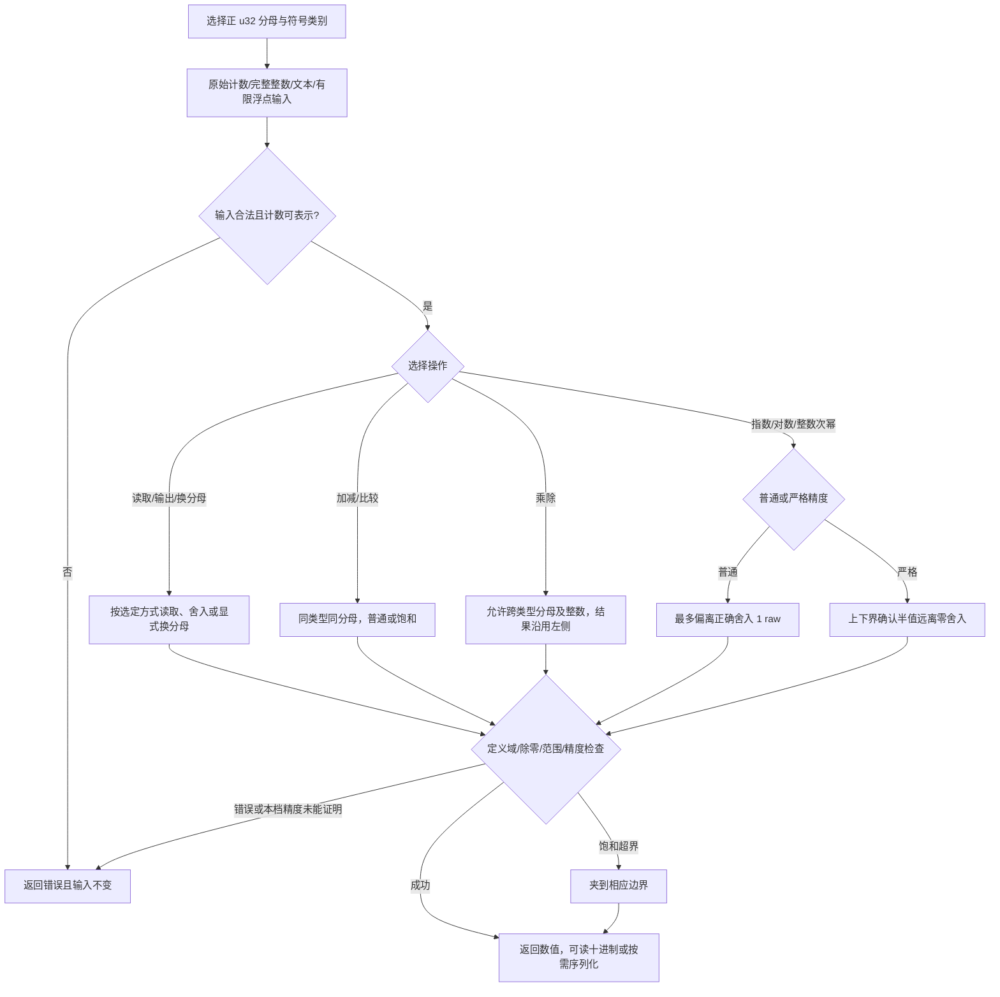

# pi-fixed-scale-int · 使用流程（L1）

源表：选择分母与类别后从原始计数、整数、文本或有限浮点输入，非法/超界输入报错；成功值可读取、输出整数或十进制、显式换分母、同类型同分母加减比较、跨类型乘除，或者选择两档指数/对数/整数次幂；计算检查定义域、除零、范围和精度；普通饱和算术可夹边界，其余失败返回错误；成功和失败都不修改原值。序列化仅在对应可选能力启用时可用，换分母后的进一步操作由调用方重新发起。
