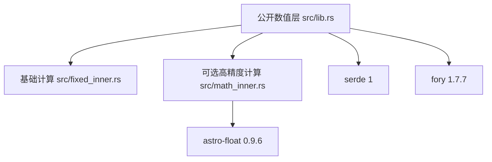

# pi-fixed-scale-int · 依赖边与模块图（L5 返工）

| 从 → 到 | 目的 / 适用条件 |
|---|---|
| 公开数值层 → 基础计算 | 委托整数算术、比例、输入与显示 |
| 公开数值层 → 可选高精度计算 | math feature 下暴露数学方法和错误 |
| 可选高精度计算 → astro-float 0.9.6 | math feature 下使用纯 Rust 多精度有向舍入 |
| 公开数值层 → serde 1 | serde feature 下派生数值序列化 |
| 公开数值层 → fory 1.7.7 | fory feature 下派生数值序列化 |

图与表的依赖边一致，无反向调用与环。本仓库此前没有分层约定，因此“越级”判据不适用；Cargo.toml 的 feature 负责使可选依赖只在启用时生效。
