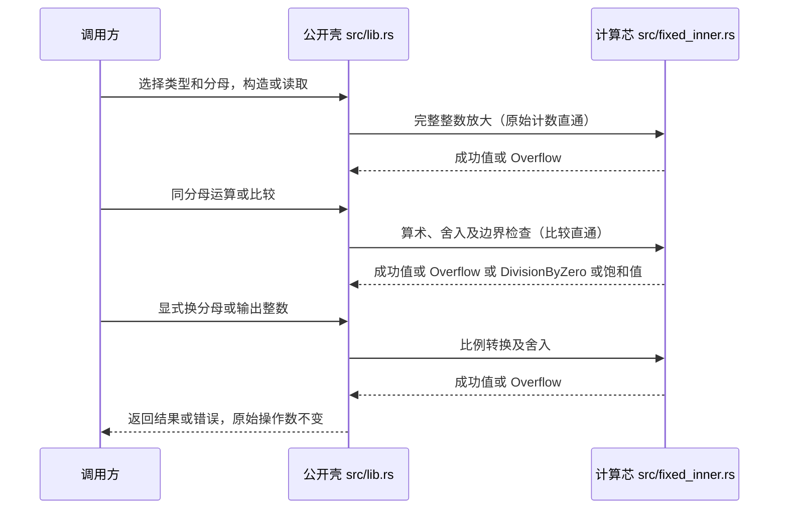

# pi-fixed-scale-int · 预期调用链（L7 精简档）

## 源表

| 行为 | 节点序列 | 成功、失败、降级 |
|---|---|---|
| 原始计数构造、读取和比较 | 调用方→lib.rs | 计数直通；零分母公开操作使用时编译失败；比较无运行时错误 |
| 完整整数输入 | 调用方→lib.rs→fixed_inner.rs→lib.rs | 放大成功或 Overflow，无饱和入口 |
| 加减 | 调用方→lib.rs→算术芯→边界芯→lib.rs | 普通成功或 Overflow，饱和夹 64 位边界 |
| 乘除 | 调用方→lib.rs→算术芯→舍入芯→边界芯→lib.rs | 成功、Overflow 或 DivisionByZero；非零除数可饱和 |
| 换分母 | 调用方→lib.rs→比例芯→舍入芯→边界芯→lib.rs | 成功或 Overflow；目标分母 0 编译失败 |
| 整数输出 | 调用方→lib.rs→舍入芯→lib.rs | 截断或半值远离零，无范围扩大 |

契约唯一落点：src/lib.rs 的类型与公开方法注释；实现预期只在 src/fixed_inner.rs 的芯桩注释。现有 src/main.rs 保留。

## 实现切片

| 顺序 | 行为及壳 | 前置 | 验收 |
|---|---|---|---|
| 1 | 常量、类型、错误与分母约束（lib.rs） | 无 | 123/100=1.23；九个便捷分母与同值自定义分母一致；u32::MAX 分母可用；两类边界计数读回；零分母公开操作编译失败 |
| 2 | 原始/完整整数输入读取与比较（lib.rs、integer 芯） | 1 | 2/100 与 2.00 不混淆；放大超界报 Overflow；同分母排序；不同分母不可直接混合运算 |
| 3 | 加减及饱和加减（算术芯） | 2 | 1.50+0.50=2.00；最大值加一普通报 Overflow、饱和得 MAX；u64 的 0-1 普通报 Overflow、饱和得 0；i64::MIN-1 普通报 Overflow、饱和夹 MIN |
| 4 | 乘除及饱和乘除（算术芯） | 3 | 1.50×0.50=0.75；相除得 3.00；普通与饱和除零均报 DivisionByZero 且原值不变；D=10 时 u64::MAX/1 普通报 Overflow、饱和夹 MAX |
| 5 | 舍入版乘除（舍入芯） | 4 | D=10 时 raw 1×5、-1×5、1÷4、-1÷4 分别验证截断与半值远离零 |
| 6 | 换分母及整数输出（比例与舍入芯） | 5 | ±125/100→±12/10 或 ±13/10，1.5→1 或 2，零目标分母编译失败 |

## 验证记录

- 声明引用网：重落后 cargo check 通过，零新增错误；芯桩运行时仍 panic，不代表功能可用。
- 零分母编译核验：cargo build --lib 后分别以 rustc --edition=2024 编译 FixedU64::<0>::from_raw(1)、FixedI64::<0>::from_raw(1).raw()、FixedU64::<0> 的相等比较、FixedU64::<10>::from_raw(1).rescale::<0>()；四个独立样例均 exit=1，诊断包含常量求值失败。只承诺公开方法与手写比较的使用，不承诺仅声明类型名或派生 Debug/Copy/Clone 操作在 D=0 时失败。

<!-- 已完成: 1 -->

<!-- 已完成: 2 -->

<!-- 已完成: 3 -->

<!-- 已完成: 4 -->

<!-- 已完成: 5 -->

<!-- 已完成: 6 -->
