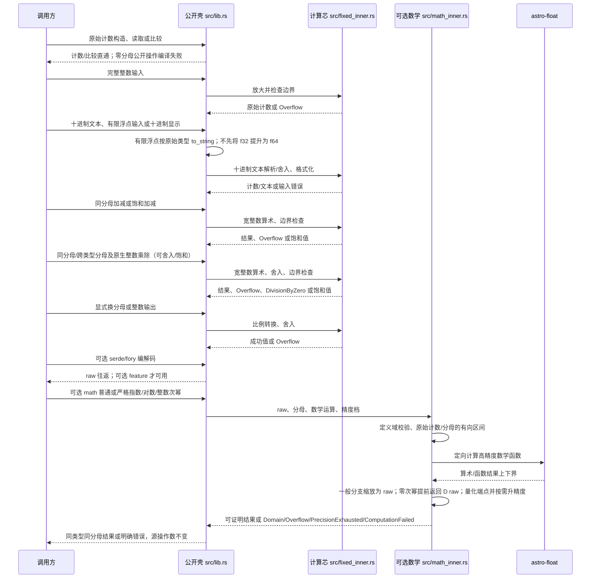
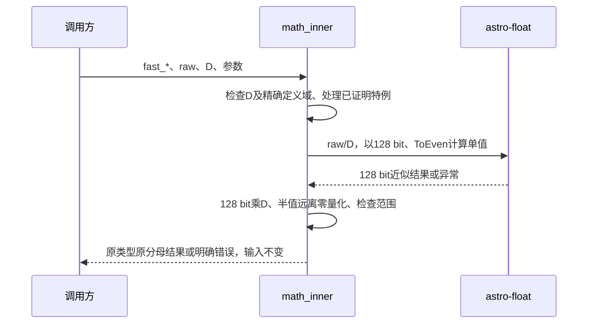

# pi-fixed-scale-int · 预期调用链（L7 精简档）



## 源表

| 行为 | 节点序列 | 成功、失败、降级 |
|---|---|---|
| 原始计数构造、读取和比较 | 调用方→lib.rs | 计数直通；零分母公开操作使用时编译失败；比较无运行时错误 |
| 完整整数输入 | 调用方→lib.rs→fixed_inner.rs→lib.rs | 放大成功或 Overflow，无饱和入口 |
| 加减 | 调用方→lib.rs→fixed_inner.rs→lib.rs | 普通成功或 Overflow，饱和夹 64 位边界 |
| 乘除 | 调用方→lib.rs→fixed_inner.rs→lib.rs | 成功、Overflow 或 DivisionByZero；非零除数可饱和 |
| 换分母 | 调用方→lib.rs→fixed_inner.rs→lib.rs | 成功或 Overflow；目标分母 0 编译失败 |
| 整数输出 | 调用方→lib.rs→fixed_inner.rs→lib.rs | 截断或半值远离零，无范围扩大 |
| 文本/浮点/整数输入与十进制显示 | 调用方→lib.rs→fixed_inner.rs→lib.rs | 浮点及对应 TryFrom 的自足契约见 src/lib.rs 的 try_from_f32/try_from_f64 注释；保留原始类型 to_string 委托，无需传递二进制分解；文本无法表示按半值远离零，非法文本报错；Debug 包含 raw 和分母 |
| 混合乘除与可选序列化 | 调用方→lib.rs→fixed_inner.rs 或 serde/fory→lib.rs | 乘除可混合类型/分母或原生整数，结果随左值；可选序列化 raw 往返 |
| math 普通方法 | 调用方→lib.rs→math_inner.rs→astro-float→math_inner.rs→lib.rs | 正确定义域中误差至多 1 raw，无法在精度上限内保证则报 PrecisionExhausted；错误不改源值 |
| math 严格方法 | 调用方→lib.rs→math_inner.rs→astro-float→math_inner.rs→lib.rs | 上下界量化一致才保证正确半值远离零舍入，否则升精度或报 PrecisionExhausted；域、范围和计算错误分别可判 |

图中的 src/fixed_inner.rs 是算术、舍入、边界检查和格式化的统一参与者；图中可选 serde/fory 调用对应 lib.rs 内的 feature 派生，非额外的运行时步骤。

原始 1–6 切片对应 src/lib.rs 的既有数值操作与 src/fixed_inner.rs；新增 math 的对外方法及 MathError 当前位于 src/math_inner.rs（由 src/lib.rs 依 feature 纳入和导出），依赖及启用条件见 Cargo.toml。需后续核对旧“壳/芯注释唯一落点”设计断言与现有公开方法实际落点是否一致；本轮只对照已存在代码，不回退生产文件。src/main.rs 保留。

## 实现切片

| 顺序 | 行为及壳 | 前置 | 验收 |
|---|---|---|---|
| 1 | 常量、类型、错误与分母约束（lib.rs） | 无 | 123/100=1.23；九个便捷分母与同值自定义分母一致；u32::MAX 分母可用；两类边界计数读回；零分母公开操作编译失败 |
| 2 | 原始/完整整数输入读取与比较（lib.rs、integer 芯） | 1 | 2/100 与 2.00 不混淆；放大超界报 Overflow；同分母排序；不同分母不可直接混合运算 |
| 3 | 加减及饱和加减（算术芯） | 2 | 1.50+0.50=2.00；最大值加一普通报 Overflow、饱和得 MAX；u64 的 0-1 普通报 Overflow、饱和得 0；i64::MIN-1 普通报 Overflow、饱和夹 MIN |
| 4 | 乘除及饱和乘除（算术芯） | 3 | 1.50×0.50=0.75；相除得 3.00；普通与饱和除零均报 DivisionByZero 且原值不变；D=10 时 u64::MAX/1 普通报 Overflow、饱和夹 MAX |
| 5 | 舍入版乘除（舍入芯） | 4 | D=10 时 raw 1×5、-1×5、1÷4、-1÷4 分别验证截断与半值远离零 |
| 6 | 换分母及整数输出（比例与舍入芯） | 5 | ±125/100→±12/10 或 ±13/10，1.5→1 或 2，零目标分母编译失败 |
| 7 | 文本/有限浮点/整数输入、十进制 Display、分母 Debug（lib.rs、fixed_inner.rs） | 1–6 | -1.25/D10→-13 raw；D=1_000_000_000 时 0.1f32、0.1f64 与文本 0.1 均为 100_000_000 raw，对应负值为 -100_000_000；两种 TryFrom 与直接浮点入口一致，f32 不先提升；非法文本、NaN、无穷和舍入后超界报错；raw 123/D100→1.23；Debug 同时见 raw 和 D；2026-10-22 修订契约后待重新验收 |
| 8 | 跨符号分母/原生整数乘除与可选 serde/fory（lib.rs、fixed_inner.rs、Cargo.toml） | 7 | 结果沿用左类型分母；1.50×(5/10)=0.75；1.50×100u8=150；除零/负结果/超界可判断；raw 序列化往返；已落地，待设计复核 |
| 9 | 可选 math、普通档指数/对数/整数次幂全集（Cargo.toml、math_inner.rs） | 7、8 | exp、exp2、ln、log2、log10、log(base)、powi（含负指数），普通结果距正确舍入最多 1 raw；0^0=1、非法定义域报错，最终舍入 raw 仍负的无符号结果越界；已落地，待设计复核 |
| 10 | 严格档全集、上下界量化与升精度（math_inner.rs） | 9 | 严格量化两端一致才返回；D=1_000_000 时 exp(1)→2_718_282、ln(2)→693_147；u32::MAX 分母及 64 位边界；无法在上限内证明时报 PrecisionExhausted；已落地，待设计复核 |

## 验证记录

- 历史记录（最初声明阶段，非当前实现）：重落声明后 cargo check 通过，零新增错误，当时芯桩仍 panic；此记录不描述当前已实现的生产代码。
- 零分母编译核验：cargo build --lib 后分别以 rustc --edition=2024 编译 FixedU64::<0>::from_raw(1)、FixedI64::<0>::from_raw(1).raw()、FixedU64::<0> 的相等比较、FixedU64::<10>::from_raw(1).rescale::<0>()；四个独立样例均 exit=1，诊断包含常量求值失败。只承诺公开方法与手写比较的使用，不承诺仅声明类型名或派生 Debug/Copy/Clone 操作在 D=0 时失败。
- 新增切片 7–10 属事后补设计，现有 tests/decimal_api.rs、tests/serialization.rs、tests/math.rs 已有代表性用例，math feature 与 x64 MSVC 全特性测试曾通过；这不等同于数学全域正确性证明。L9 应独立核对依赖有向舍入、上下界封闭性、舍入分界、溢出及不变量，尤其对极端指数与基数接近 1 的路径。若不能证明某分支满足严格契约，应标记缺口，不能将票据标“已完成”。

## L9 轻审发现的核验任务（尚未验证完成）

| 核验对象 | 可执行判据 | 影响切片与结论 |
|---|---|---|
| 输入有向区间 | 对整数原始计数/分母的 Down/Up 运算核实 lo≤精确有理数≤hi；含负数、0、u32::MAX、64 位极值 | 9、10；前提不成立则两档精度保证均无效 |
| 单调函数与组合 | 对 exp、exp2、ln、log2、log10、powi 的定义域/单调性、有向舍入 API 的库级保证核对；对 log(base) 除法确认分母区间不跨零且四端覆盖所有符号组合 | 9、10；每一步保留真值封闭区间 |
| 缩放、量化与半值 | 将结果区间乘分母前后核实端点顺序；量化遵守正负半值远离零；严格版仅端点同 raw 才成功；普通版端点相差≤1 raw 且均在目标范围内才成功 | 9、10；否则升精度或显式报错，不用样例替代证明 |
| 异常与边界 | 对数非正、底数非正或为一、0 的负次幂、0^0、无符号负结果、64 位溢出、精度耗尽及计算失败分别覆盖；本机复跑 math、默认与 x64 全特性测试 | 7–10；定义域/越界/精度错误不改源值 |

## 有限区间组合证明（作为切片 9–10 的验收依据）

依赖正确舍入及实际 Down/Up 方向的源代码证据见 05-modules/decisions.md。本节的前提是所有参与端点均为有限值、无底层错误、下界不大于上界；出现 NaN 或无穷须先走独立异常分支，不能套用本节。浮点端点是确定的二进制数，而不是以 inexact 标记隐式代替本项目区间宽度。

1. **输入**：原始计数绝对值不超过 u64::MAX，分母不超过 u32::MAX。起始精度至少 128 bit，二者整数转换均精确。对正 D，令 L=Down(raw/D)、U=Up(raw/D)，由有向正确舍入得 L≤raw/D≤U。对数输入为正时须确认 L>0，或提升精度后再算。
2. **单调函数**：exp、以 2 为底的指数在实数上递增，ln、log2、log10 在正数上递增。故 Down(f(L))≤f(x)≤Up(f(U))。exp2 实现为精确常量 2 的幂，2>1，指数方向一致。
3. **整数幂**：n=0 的数学结果为 1，提前返回 D raw，跳过后续统一缩放。对 n≠0 先按精确整数的绝对值构造正区间 [a,b]；k=|n| 时 t^k 在非负数上递增，取得 [Down(a^k),Up(b^k)]。n<0 要求 raw≠0 且幂区间端点均>0，倒数递减，交换端点为 [Down(1/U),Up(1/L)]。负原值且奇次幂再精确变号并交换端点 [-U,-L]。不允许在正幂已超出依赖指数范围后把两端无穷取倒数当作精确零。
4. **指定底数对数**：分别包住 ln(x) 和 ln(base)。base>0 且不为 1；分母区间若跨零，提升精度，不做四端除法。若分母区间不含零，连续有理函数 a/b 在矩形上的极值位于四角，取四个 Down 商的最小值及四个 Up 商的最大值即包住真实比值，亦覆盖 base<1 的负分母情形。四角任一 NaN/底层错误必须传播，不允许 min/max 忽略它。
5. **缩放**：D 是精确正整数，[Down(L·D),Up(U·D)] 继续包住数学结果的精确 raw。
6. **量化**：Q(t)=sgn(t)·floor(|t|+1/2) 在实数上单调（包括正负半值跳点）。因此 Q(L)≤Q(y)≤Q(U)。两端同整数则严格结果唯一；两端相差≤1 且均在目标范围，返回下界相对正确舍入最多差 1 raw。比较半值使用精确可表示的 (2k+1)/2，当前搜索阈值以内整数所需位数小于起始精度，二分与比较不产生 f64 误差。
7. **范围和资源**：如果 Q(L)>MAX 或 Q(U)<MIN，真值的正确舍入也越界；若区间横跨范围边界则继续升精度，不先夹边。若尚未证明精度保证，必须返回 PrecisionExhausted，不能通过扩大误差或自动改成普通档成功。NaN/依赖资源错误返回 ComputationFailed；这与不合法输入的 Domain 不同。

### 尚须落实的实现与回归保护

- Interval 明确约束两端有限、无底层错误且 lo≤hi；在函数结果、四角除法、倒数和最终缩放后校验，失败不参与 min/max。无穷若没有独立的数学界证明，一律保守返回 ComputationFailed；合法输入不保证所有计算都成功，但任何成功结果必须符合本档精度保证。
- exp/exp2 的 x>100/ x<-100 早退可以独立证明：2^100>u64::MAX，e^100>2^100；2^-100·u32::MAX<1/2 且 e^-100<2^-100，故分别越界或正确舍入为零。这只覆盖这些指数函数，不自动授权整数幂的任意指数早退。
- 需通过可控低精度/上限的内部测试验证两档分歧和 PrecisionExhausted 分支；通过精确有理幂的独立整数基准验证半值和极值，而不是仅比较普通版与同一后端严格版。
- 公开方法说明每个错误分支、参数域、返回的类别/分母和无副作用；此任务涉及生产契约及实现保护，交下游实现处理，不能用“补设计文档”冒充已经完成。

### 用户裁定后的交接合同

范围以最终正确舍入 raw 为准；无符号微小负真值舍入为零可成功。NaN、底层错误、无独立证明的无穷或倒置区间统一返回 ComputationFailed；对数商分母区间跨零、负幂倒数前有效区间有零端点则提升精度，上限用尽报 PrecisionExhausted。四角聚合前和倒数前须验证，事后检查不能替代。所有 evaluate 的成功返回均为 raw 单位，零次幂提前返回 [D,D] 是例外控制流而非遗漏缩放。图中 lib.rs 是逻辑公共类型层，实际 math 方法定义在 math_inner.rs，不表示每次调用都经过一个 lib.rs 函数。

| 顺序 | 待实现行为 | 前置 | 验收 |
|---|---|---|---|
| 11 | math 有限区间有效性、四角异常传播及负幂倒数保护（math_inner.rs） | 9、10 的现有实现 | 所有有效端点有限、无 err、lo≤hi；NaN/无穷/倒置在聚合或倒数前报 ComputationFailed；零端点和跨零按规则重试/耗尽，不返回伪精确零 |
| 12 | 独立基准与资源分支覆盖、自足公开数学契约（math_inner.rs、tests/math.rs） | 11 | 精确有理幂/负幂及正负半值整数基准；可控精度耗尽和异常输入路径；微小负值舍入零；定义域/范围/i32::MIN；公开错误条件、单位和状态完整；默认/math/x64 全特性通过 |

说明：src/math_inner.rs 中 `powi(0)` 在 `evaluate` 内提前返回 raw 分母对应的 1，因此跳过末尾统一缩放，不产生二次乘分母；`tests/math.rs` 已包含 D>1、0^0 的样例。曾有审查意见误判该分支，复核时必须以控制流和实际验证为依据。此册是已实现代码的事后设计对拍，L7 “只落壳芯不写逻辑体”标准不能反向用于要求删除生产实现；当前是否能满足该技能的设计态放行条件须在审查报告如实说明。
## 固定128 bit快速近似档（新增设计，尚未实现）

本节扩展快速档，不改变前文普通/严格档合同；沿用math feature、astro-float依赖和既有模块边界，不新增依赖。本轮仅文字设计，不新增实现或空桩，不回退已有代码；旧审查不作为本节放行依据。

### 接口与契约

FixedI64<D>和FixedU64<D>均提供如下接口，结果保持原类别及分母，值为raw/D。D为正u32，D=0使用方法时编译失败。base为同类型同分母值；n接受全部i32（含i32::MIN）。

```rust
pub fn fast_exp(self) -> Result<Self, MathError>;
pub fn fast_exp2(self) -> Result<Self, MathError>;
pub fn fast_ln(self) -> Result<Self, MathError>;
pub fn fast_log2(self) -> Result<Self, MathError>;
pub fn fast_log10(self) -> Result<Self, MathError>;
pub fn fast_log(self, base: Self) -> Result<Self, MathError>;
pub fn fast_powi(self, n: i32) -> Result<Self, MathError>;
```

所有本项目后端算术/函数调用请求128 bit结果精度，使用ToEven最近舍入，计算单值近似，不建立上下界、不自适应升精度、不回退其他档；后端内部保护位不受此限制。最终近似值乘D后半值远离零量化为raw。不承诺统一1 raw数学误差，不承诺在半值或范围分界附近与普通/严格档一致，不承诺固定耗时或性能倍数。成功和失败均不修改输入及外部状态。

Domain：非正对数输入、非正或为一的底数、零的负次幂。Overflow：最终近似raw超出目标范围，或独立数学边界证明越界；无符号近似负结果量化零可成功。ComputationFailed：后端错误、NaN、无独立证明的无穷、合法底数的近似对数分母为零、负幂中间计算失效。快速档不返回PrecisionExhausted。0^0=1，零次幂直接返回D raw，不二次缩放。只允许有独立证明的零/溢出早退，不将中间无穷取倒数当零。

### 预期调用链



| 行为 | 设计 | 失败、不做什么 |
|---|---|---|
| 单值计算 | 固定请求128 bit，ToEven | 不调用上下界evaluate或自适应compute，不升精度，不返回PrecisionExhausted |
| 指数对数 | exp、2的幂、ln、log2、log10；指定底数用ln(x)/ln(base) | 精确定义域非法报Domain；合法底数的近似对数分母零报ComputationFailed |
| 整数幂 | 绝对值正幂、负指数倒数、负底数奇次幂恢复符号，安全处理i32::MIN，0^0返回D raw | 中间错误/非数/无证明无穷报ComputationFailed，不将幂溢出取倒数当零 |
| 量化 | 精确比较半值、远离零量化，按近似raw检查范围 | 超界报Overflow，无符号近似负结果量化零可成功 |
| 兼容 | 普通/严格算法及保证不变 | 不宣称固定耗时、倍数或统一误差 |

示意流程（非实现证据）：检查D与精确定义域 → 精确特例/已证明早退 → 128 bit单值输入 → 指定函数计算 → 各中间结果有限且无错误（对数分母非零）→ 128 bit缩放为raw → 半值远离零量化 → 范围检查 → 返回；失败与成功均不改源值。

### 新增实现切片

| 顺序 | 待实现行为 | 前置 | 验收 |
|---|---|---|---|
| 13 | 七个fast公开方法及固定128 bit单值计算（src/math_inner.rs） | 既有math依赖及公共类型，不以未完成10–12为新增前置 | 七方法、两类数值、非十进制分母、精确特例、正负指数/i32::MIN、定义域、近似范围、异常传播；内部可观察测试确认仅请求128 bit且不走自适应路径 |
| 14 | 快速档独立验收和自足公开契约（src/math_inner.rs及配对测试） | 13 | D100时exp2(0)、ln(1)、log(100,10)、powi(2,-1)的raw分别100、0、200、50；D10时powi(-2,3)为-80；独立精确恒等式及代表性数学值、正负半值、错误后状态、普通/严格回归；不强加统一1 raw或所有近似输入成功；默认/math/可用x64全特性验证，环境阻塞单列 |

<!-- 已完成票据记录在本文档同目录的 completed-tickets.md -->
